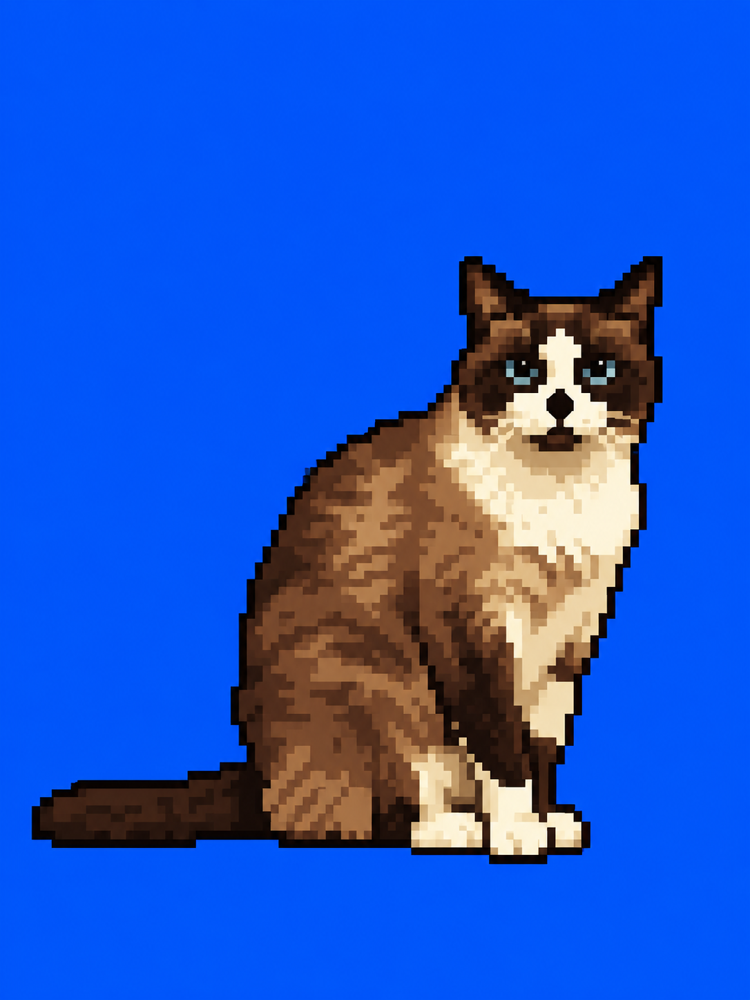
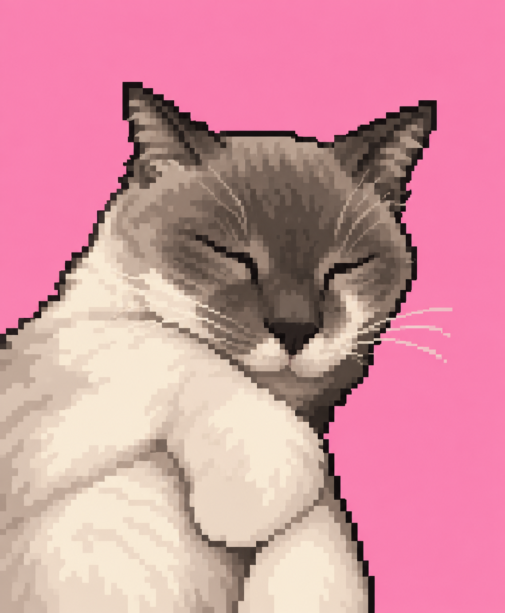

::: {.cover}

{.event-logo fig-alt="event logo"}

::: {.title-block}
[big title here]{.title}

[subtitle that adds a bit of context]{.subtitle}
:::

::: {.cover-footer}

::: {.authors}
[your name]{.name}
co-author, advisor, team, etc...
:::

::: {.logos}
{fig-alt="logo one"}
{fig-alt="logo two"}
:::

:::

:::

## bullets, one click at a time

::: {.incremental}
- wrap a list in `.incremental` and each bullet shows up on click
- markers are black, text is gray
- keep 'em short
:::

## quotes come with a source

::: {.incremental}
- plain bullet first, quote on the next click
:::

::: {.fragment}
> “use `>` for a quote; it gets the gray card with the black rule on the left”
> [somebody important (2026)]{.source}
:::

## two columns, two boxes

:::: {.columns}

::: {.column .box .fragment}
### left side {.fragment}

::: {.incremental}
- `.box` adds the black line on top
- `.column` splits the width evenly
:::
:::

::: {.column .box .fragment}
### right side {.fragment}

::: {.incremental}
- `###` works as a small kicker
- each piece can be its own fragment
:::
:::

::::

## highlight the part that matters

::::: {.columns}

:::: {.column}

::: {.box .fragment}

::: {.fragment}
> you can mark [just a chunk of the sentence with the highlighter]{.fragment .highlight} and it draws itself on click
> [author (2026)]{.source}
:::
:::

::: {.incremental}
- the stroke only stays on during its own click
- then it fades back to gray
:::

::::

:::: {.column}

::: {.box .fragment}

::: {.incremental}
- boxes can hold bullets too
:::
:::

::: {.fragment}
> [“short quotes work great here”]{.fragment .highlight}
> [author (2026)]{.source}
:::

::: {.incremental}
- you can keep stacking stuff below
:::

::::

:::::

## main text, detail, source

::: {.fragment}
> a full-width quote can sit on top to frame the whole slide
> [author (2026)]{.source}
:::

::::: {.columns}

:::: {.column}

::: {.box .fragment}
### option I {.fragment}

::: {.fragment}
main point in regular size
[`.detail` for a smaller supporting line]{.detail}
[`.source` for the reference]{.source}
:::
:::

::::

:::: {.column}

::: {.box .fragment}
### option II {.fragment}

::: {.fragment}
same structure, different content
[handy for compare and contrast]{.detail}
[another author (2026)]{.source}
:::
:::

::::

:::::

---

::: {.cover}

{.event-logo fig-alt="event logo"}

::: {.title-block}
[thank you!]{.title}

[questions, comments, hot takes welcome]{.subtitle}
:::

::: {.cover-footer}

::: {.authors}
[your name]{.name}
your.email@example.com
:::

::: {.logos}
{fig-alt="logo one"}
{fig-alt="logo two"}
:::

:::

:::
